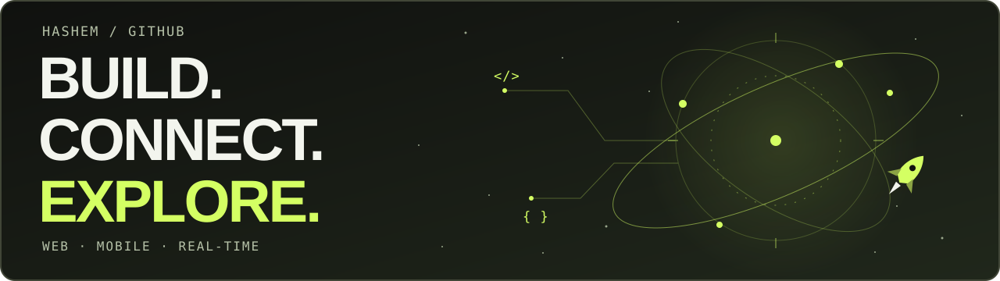

# Hashem Alkhanaizi

I build web apps, real-time systems, and multiplayer experiments. This account is where interfaces meet APIs, packets, and simulations.

**[Portfolio & project demos →](https://alkhanaizi.dev/)** · [LinkedIn](https://www.linkedin.com/in/hashem-alkhanizi-5312822a6)

## The stack

| Layer | Technologies used in my repositories |
| --- | --- |
| **Languages** | TypeScript · JavaScript · Go · Rust · Dart · Python |
| **Web** | React · Next.js · Angular · NestJS · Express |
| **Mobile** | Flutter · React Native · Expo |
| **Data** | PostgreSQL · SQLite · Prisma · Firebase |
| **Real-time & systems** | WebSockets · UDP · Macroquad · SDL2 |

## From interface to infrastructure

| Repository | Inside | Stack |
| --- | --- | --- |
| [social-network](https://github.com/Alkhanizi-hashem/social-network) | Collaborative social app: feeds, groups, and live chat | Next.js · Go · WebSockets |
| [TaskFlow](https://github.com/Alkhanizi-hashem/TaskFlow) | Work boards, role-based workflows, and activity history | Next.js · NestJS · PostgreSQL |
| [multiplayer-fps](https://github.com/Alkhanizi-hashem/multiplayer-fps) | Authoritative game server, movement prediction, and UDP networking | Rust · Macroquad |
| [smart-road](https://github.com/Alkhanizi-hashem/smart-road) | Collaborative intersection simulation with crossing reservations | Rust · SDL2 |
| [localhost](https://github.com/Alkhanizi-hashem/localhost) | HTTP server with epoll, CGI, sessions, and uploads | Rust |
| [stock-market](https://github.com/Alkhanizi-hashem/stock-market) | Mobile market simulator with holdings and transaction accounting | Expo · React Native · SQLite |

Also in orbit: a [JavaScript mini-framework](https://github.com/Alkhanizi-hashem/mini-framework), a [Go real-time forum](https://github.com/Alkhanizi-hashem/real-time-forum), [Flutter messaging](https://github.com/Alkhanizi-hashem/secure-messenger), and an [Angular review workflow](https://github.com/Alkhanizi-hashem/penny-frontend-assessment).
